# Software Requirements Specification (SRS) — Final Version
## InventaireMed — Inventory Management System (*Gestion de Stock*)

| | |
|---|---|
| **Version** | Final (consolidates SRS V1, V2 and V3) |
| **Platform** | Desktop (Kotlin Multiplatform / Compose Multiplatform, JVM) |
| **Currency** | Algerian Dinar (DZD) |
| **Languages** | French and English (instant toggle) |

---

## 1. Introduction

### 1.1 Purpose
This document specifies the requirements of InventaireMed: its data model, entity relationships, business rules, screens and technical constraints.

### 1.2 Scope
The system manages the flow of stock from suppliers (*fournisseurs*) to internal departments (*services / locaux*) across the **whole hospital** — pharmaceuticals, medical supplies, IT equipment, office supplies and hardware. It covers procurement agreements (conventions), orders, deliveries, internal issues, donations, consumption analytics, personnel assignment, auditing and reporting.

### 1.3 Localization
Core data is language-independent. The UI **must support English and French**, switchable instantly without restart or data loss.

### 1.4 Definitions
| Term | Meaning |
|---|---|
| Convention | Framework procurement agreement with a supplier (quotas, ceiling, TVA) |
| BC (Bon de Commande) | Purchase order |
| BL (Bon de Livraison) | Delivery note (goods received) |
| BS (Bon de Sortie) | Issue note (goods issued to a service) |
| Décharge / Don | Donation received outside supplier conventions |
| Dotation | Allocation of an item to a person |
| TVA | Value-added tax |

---

## 2. Data Model

### 2.1 Fournisseur (Supplier)
ID, full name, address/reference (e.g. `FRN-0004`), active/approved status.

### 2.2 Convention
- ID, order number (OrdNumber), signature date, global ceiling (*Plafond*, total amount).
- **TVA %** (optional): applied automatically to the total of orders placed under the convention.
- **Items collection**: designation, unit type, agreed quantity (quota), minimum quantity (low-stock threshold), unit price.
- Tracks per-article quota: ordered, consumed, remaining.

### 2.3 Internal Organization
- **Service**: ID, name, code (`localNum`), head of service (*Chef de service*).
- **Local**: physical room or storage area belonging to exactly one Service.
- **Person**: ID, full name, date of birth, service, free-text note/role (*autre*).
  - A Chef de Service is a Person; `Chef de Service (1) → (1) Service`; `Service (1) → (*) Person`.

### 2.4 Article (Stock)
- Code, additional reference / barcode (`additional_referenceId`), designation.
- Family and sub-family (selected from configured lists), unit, quantity, minimum quantity, unit price (weighted average — PMP), total value.
- `expiration_date` for perishable control, entry date.
- Status: **Active**, **Archived**, **Obsolete** (articles are never deleted).

### 2.5 Transaction Documents
| Document | Key fields | Stock effect |
|---|---|---|
| **Bon de Commande** | number, supplier, date, lines, HT/TVA/TTC totals, status | none (commitment) |
| **Bon de Livraison** | supplier BL number, reception date, linked BC, reception mode (complete/partial), lines (quantity received, lot number), beneficiary personnel, chef de service | **increases** stock |
| **Bon de Sortie** | system number, paper stub ref, date & time (auto *now*, manual override), requester, receiving service, local, chef de service, beneficiary personnel (optional, multi-select), free-text motif, lines | **decreases** stock |
| **Décharge / Don** | number, organization name, donor, date, lines | **increases** stock, price forced to 0 |

### 2.6 Relationships
1. Convention → Supplier: each convention belongs to one supplier; a supplier may have many conventions.
2. Commande → Supplier; Livraison → Supplier.
3. Service (1) → (*) Local; Bon de Sortie → a Local of a Service.
4. Service (1) → (*) Person.
5. Article (1) → (*) Person (personal allocation / dotation).

---

## 3. Functional Requirements by Screen

### 3.1 Gestion de Stock (Master Inventory)
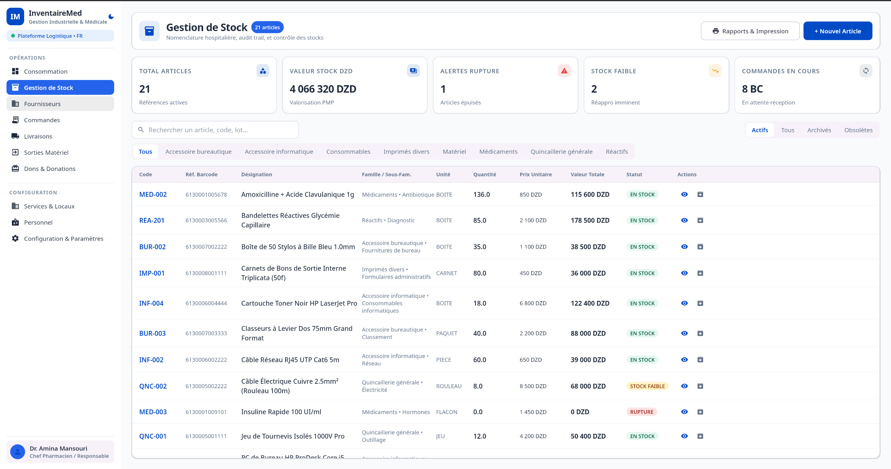

- KPI cards: total articles, stock value (PMP), out-of-stock alerts, low-stock count, pending orders.
- Search by article, code or lot; filter by family tabs and status (Active / All / Archived / Obsolete).
- Table: code, barcode ref, designation, family/sub-family, unit, quantity, unit price, total value, status badge (*En stock*, *Stock faible*, *Rupture*).
- **FR-STK-1** Family and sub-family are chosen from dropdowns only; new categories are added in Configuration.
- **FR-STK-2** No delete button: articles can only be archived or marked obsolete.
- **FR-STK-3** Opening an article shows a detail screen. Editing requires an audit entry: date, old vs new value, and a mandatory cause typed by the user.
- **FR-STK-4** Reports & printing with dynamic column selection (e.g. hide financial data) and filters by product, service and date range.

### 3.2 Fournisseurs & Conventions
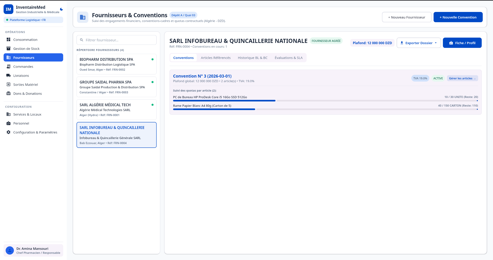

- Supplier directory with filter; tabs: Conventions, Referenced articles, BL/BC history, Evaluations/SLA.
- Per-convention quota progress bars (ordered / total, remaining).
- **FR-CNV-1** Optional TVA % per convention, applied automatically to order totals.
- **FR-CNV-2** Date and time fields use calendar and time pickers, not free text.
- **FR-CNV-3** Editing an article under an active convention requires explicit confirmation.

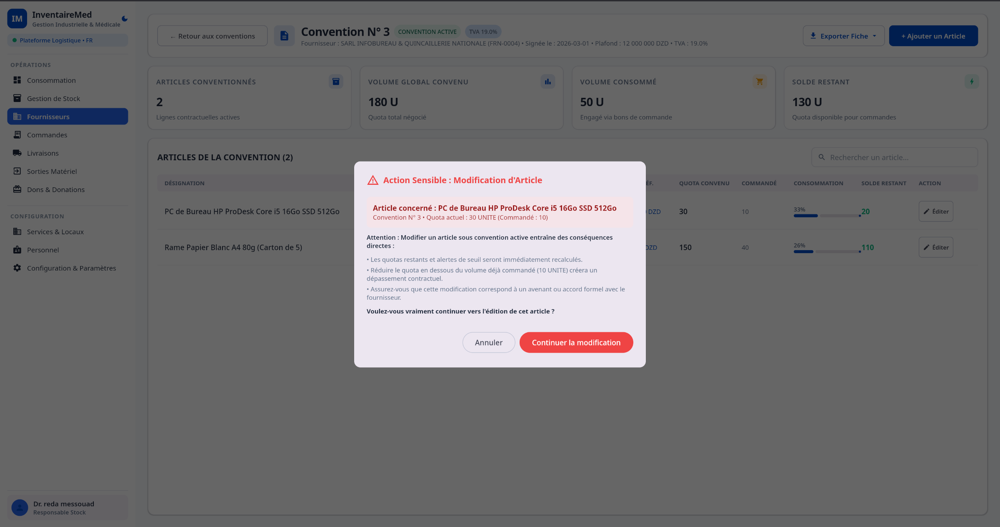

The warning explains that remaining quotas are recalculated, that reducing a quota below the already-ordered volume creates a contractual overrun, and that the change should match a formal amendment.

### 3.3 Commandes (Orders)
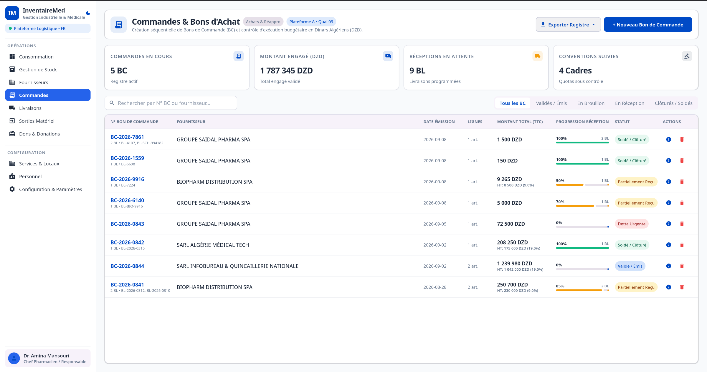

- KPIs: open orders, committed amount, pending receptions, tracked conventions.
- Filter by status: all, validated/issued, draft, in reception, closed/settled.
- Columns: BC number (with linked BLs), supplier, date, line count, TTC total (with HT and TVA), reception progress, status.
- **FR-ORD-1** Clicking an order opens a detail view showing which lines are delivered (*Livré*) and which remain (*Pour livraison partielle*).
- **FR-ORD-2** Standard orders cannot exceed the remaining convention quantity (e.g. 1,000 reams − 200 ordered = 800 left).
- **FR-ORD-3** **Urgent debt order** (*Dette urgente*): when a quota is exhausted, an order may bypass the limit; unit price and dates become editable (price change before next convention, supplementary budget).
- Orders show and filter by sub-family.

### 3.4 Livraisons (Deliveries)
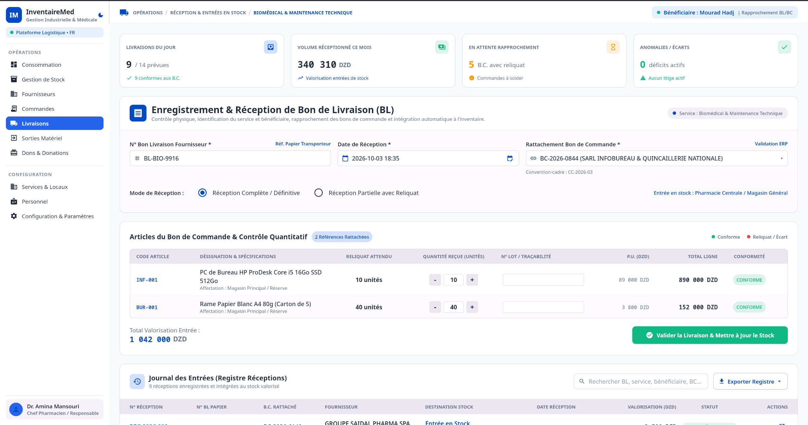

- Registration form: supplier BL number, reception date/time, linked purchase order, reception mode (complete or partial with remainder).
- Line control: expected remainder, received quantity (+/−), lot/traceability number, unit price, line total, conformity indicator.
- Reception journal with search and export.
- **FR-DLV-1** Track the beneficiary personnel and chef de service of the receiving service.
- **FR-DLV-2** The "Quai" (dock) and "Agent réception" fields and the "attach paper slip" requirement are removed.
- **FR-DLV-3** Validating a delivery automatically increases stock.

### 3.5 Sorties Matériel (Issue Notes)
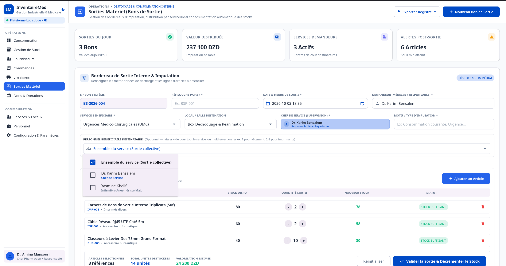

- KPIs: issues today, distributed value, requesting services, post-issue alerts.
- Form: system number (auto), paper stub ref, date & time, requester, beneficiary service, local, chef de service, motif, optional beneficiary personnel (whole service or specific people).
- Lines show available stock, issued quantity, new stock and status (*Stock suffisant*).
- **FR-OUT-1** Requester and internal receiver names must be persisted and shown in history after validation.
- **FR-OUT-2** Date/time defaults to now, with a picker for override.
- **FR-OUT-3** Line list starts empty (no mock products).
- **FR-OUT-4** Motif / imputation is a **free-text** field.
- **FR-OUT-5** Validating an issue decreases stock immediately and reactively across all screens.

### 3.6 Consommation (Consumption Tracking)
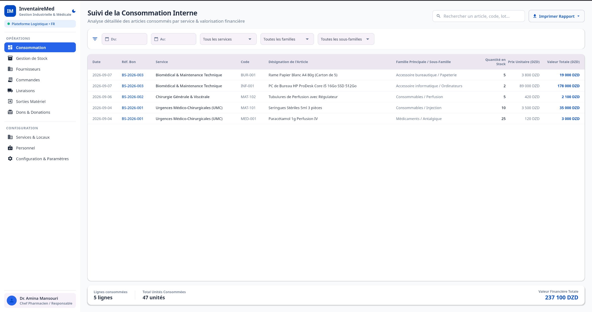

- Lists all articles consumed by internal services.
- Filters: date range (from/to), service, family, sub-family.
- Columns: date, voucher ref, service, code, designation, family/sub-family, quantity, unit price, total value.
- Footer: consumed lines, total units, **total financial value** for the active filters.
- Clicking a row opens the consumption record detail; a **Print** button generates a report with exactly the applied filters.

### 3.7 Dons & Donations (Papiers de Décharge)
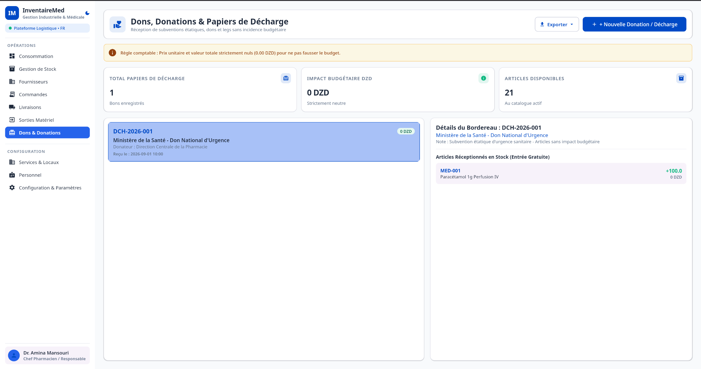

- Receives items outside supplier conventions (state grants, gifts).
- Works like a delivery but records organization name and donor.
- **FR-DON-1** Unit price and totals are strictly 0 — stock rises, financial ledgers are unaffected.
- UI text uses "Donations" (not "Dotations"). KPIs: total vouchers, budget impact (0 DZD), available articles.

### 3.8 Services & Locaux
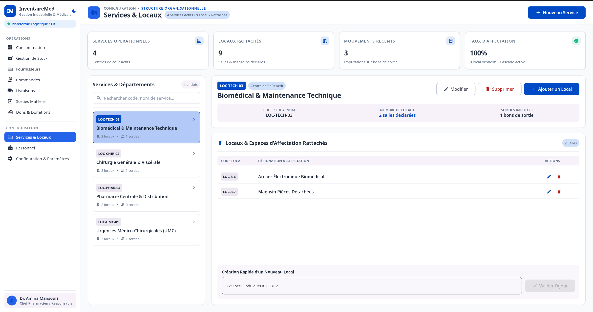

- Master list of services with search; detail with attached locals, issued-note count, and quick local creation.
- **FR-SRV-1** No instructional filler text; an outer fixed-size column holds an inner scrollable list.

### 3.9 Personnel
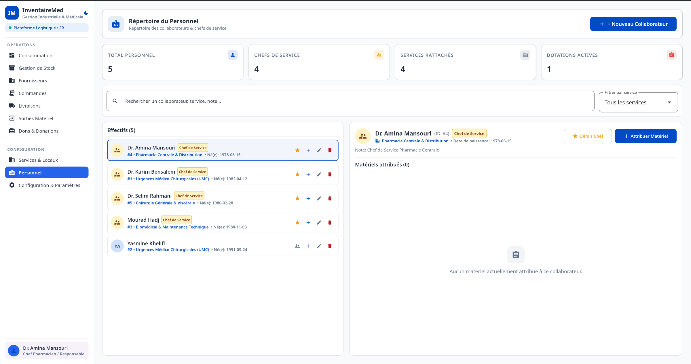

- Staff directory: name, service, birth date, note; promote/demote chef de service; filter by service.
- **FR-PER-1** Items can be allocated (*Attribuer matériel*) to individual persons for traceability of assets (equipment, uniforms, laptops).

### 3.10 Configuration & Paramètres
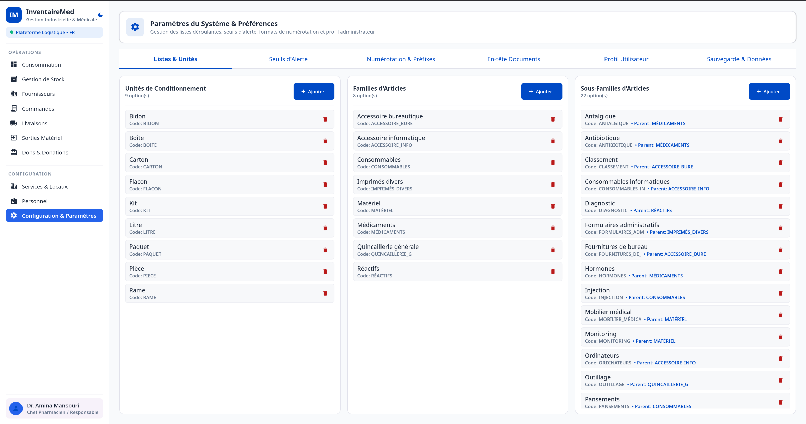

Tabs: lists & units, alert thresholds, numbering & prefixes, document headers, user profile, backup & data.

- **FR-CFG-1** Manage packaging units (Boîte, Carton, Flacon, Litre, Pièce, Rame…), families and sub-families (add / edit / remove).
- **FR-CFG-2** Global default minimum quantity applied when an article has none.
- **FR-CFG-3** Customizable document prefixes (e.g. `CMD-2026-001`).
- **FR-CFG-4** Institutional document header for printed documents.
- **FR-CFG-5** Database backup.

### 3.11 User Profile & Preferences
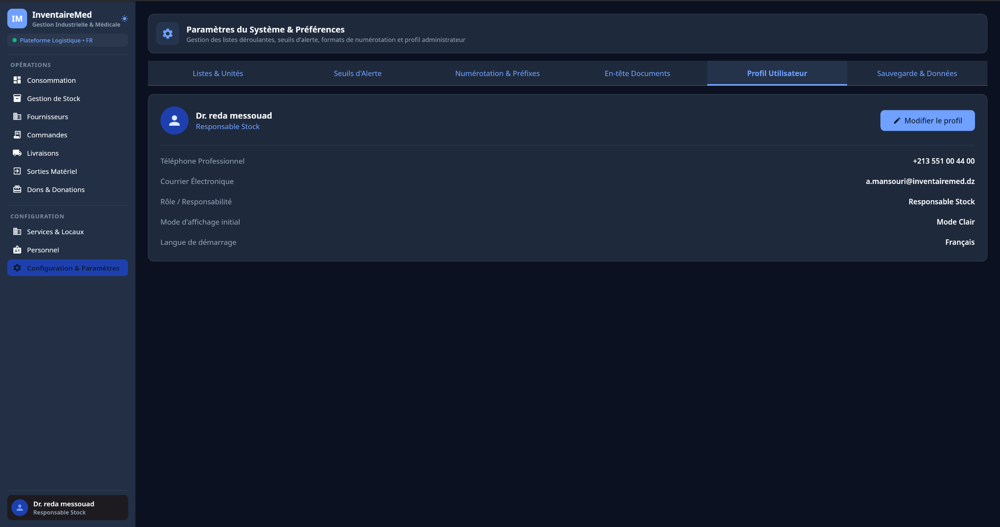

- Edit full name, phone, email, role.
- Light / dark mode toggle.
- Instant English/French toggle.

---

## 4. Cross-Cutting Business Rules

### 4.1 Stock Automation
- Saving a **BL** or **Don** adds quantities to stock; saving a **BS** deducts them.
- Article quantity, status and alerts (low stock / out of stock) are recomputed after each movement.

### 4.2 Import / Export
- CSV import and export for all tables; export of a blank template (headers only) for external filling in Excel and re-import.
- Registers and reports can be exported/printed from each operational screen.

### 4.3 Data Integrity & Audit
- No hard deletion of master articles (archive / obsolete only).
- Audit log for article edits: timestamp, old/new values, required cause.

---

## 5. Non-Functional & Technical Requirements

### 5.1 Reactivity
All data sources expose reactive streams (SQLDelight `asFlow().mapToList()`); ViewModels hold `StateFlow` collected in Compose. A change on one screen (e.g. stock after a *Sortie*, a new family) is immediately visible on all others.

### 5.2 UI Architecture
- Screens are split into small reusable composables (e.g. filter bars, detail tables).
- Every list is scrollable (`LazyColumn` / `verticalScroll`) to be safe on small windows.
- Material 3 design system, light and dark themes.

### 5.3 Persistence & Deployment
- Local SQLite database stored in the user profile (`~/.inventairemed/inventory.db`), independent of application binaries so data survives upgrades.
- Windows installers use a permanent `upgradeUuid` for in-place major upgrades; `.deb` / `.rpm` / `.msi` / `.exe` builds via CI/CD.

### 5.4 Development Seeding
- Mock data can be injected via `-PseedDbPath="path/to/seed"` at build time.
- Seed logic is removed from the dependency-injection graph in production builds.
- Test categories: *Quincaillerie générale*, *Accessoire informatique*, *Accessoire bureautique*, *Imprimés divers*.

### 5.5 Technology Stack
Kotlin 2.x, Compose Multiplatform, SQLDelight, Koin (DI), Gradle.

---

## 6. Traceability Summary

| Screen | Primary requirements |
|---|---|
| Stock | FR-STK-1…4 |
| Suppliers & Conventions | FR-CNV-1…3 |
| Orders | FR-ORD-1…3 |
| Deliveries | FR-DLV-1…3 |
| Issue notes | FR-OUT-1…5 |
| Consumption | filters, total, detail, print |
| Donations | FR-DON-1 |
| Services & Locals | FR-SRV-1 |
| Personnel | FR-PER-1 |
| Configuration | FR-CFG-1…5 |
